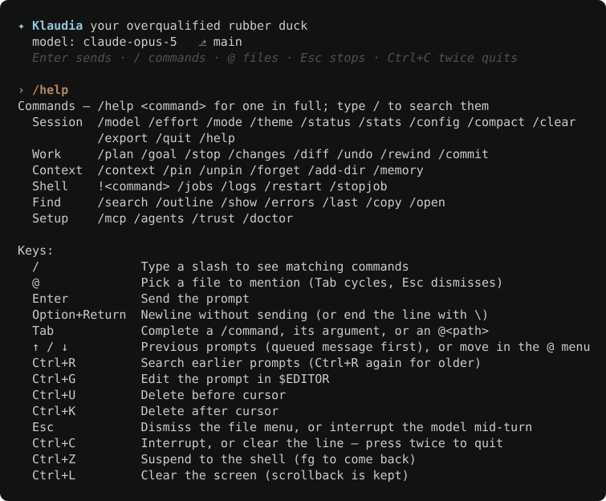

# Klaudia

A locally-buildable, extensible coding agent — a single static Go binary (Linux +
macOS), no runtime dependencies. Klaudia began as a cleanroom of Claude Code
(v2.1.66) and was ported to Go; the JavaScript reference is retired (preserved on
the `js-reference` branch). See [Background](#background) for the story and
[docs/parity.md](docs/parity.md) for the feature map.



Klaudia keeps full parity with the reference and then builds past it — the
extras we lean on day to day:

- **[Code intelligence (LSP)](#code-intelligence-lsp)** — real diagnostics and
  go-to-definition from language servers you already have installed.
- **[Memory & project knowledge](#memory--project-knowledge)** — a `MEMORY.md`
  index that links out to detail notes, recalled into every session.
- **[Themes](#themes)** — the whole UI (banner, prompts, menus, Markdown)
  recolors, persisted in config.
- **[Standing goals](#goals--autonomous-iteration)** — `/goal` pins an objective
  that's re-stated to the model every turn.
- **[Editor integration (ACP)](#editors-acp)** — `--input-format acp` makes
  Klaudia the agent behind Zed, `acp.nvim` or the JetBrains plugin.
- **[Isolated sub-agents](#your-changes-and-klaudias)** — children that write
  get their own git checkout, so two of them can work at once.
- **[Effort](#effort)** — `--effort` and `/effort` set how hard the model works
  per response, on both the Anthropic and OpenAI-compatible backends.
- **[Background work that reports back](#long-running-commands-logs-and-your-shell)**
  — a job or sub-agent that finishes wakes the model, so a long build needs
  no polling.
- **[`/rewind`](#your-changes-and-klaudias)** — back to before any earlier
  prompt, files and conversation together.
- Plus [OS/container Bash sandboxing](#sandboxing-the-bash-tool), local
  [web search & browsing](#web-search--browsing), [MCP](#mcp), and
  [skills](#skills).

## Getting started

### Install

```bash
CGO_ENABLED=0 go install github.com/greenthread-ai/klaudia/cmd/klaudia@latest
```

This installs the `klaudia` binary into `$(go env GOPATH)/bin` (commonly
`~/go/bin`) — make sure that's on your `PATH`. `@latest` is the newest tagged
release; `@main` tracks HEAD. `@latest` routes through `proxy.golang.org` and
can lag a fresh tag by a few minutes — to force a refresh, prefix the command
with `GOPROXY=direct`.

Or take a prebuilt binary: each release on the GitHub releases page ships
`klaudia_<version>_<os>_<arch>.tar.gz` for macOS and Linux on amd64 and arm64
(no Windows build — it compiles, but nobody has run it), with
`checksums.txt` to verify against. `klaudia --version` prints the version and
the commit the binary was built from.

Prefer to build from a checkout? See [Build](#build).

### Create a config (optional but recommended)

Klaudia reads `~/.klaudia/config.toml` automatically for every run; a project
`./.klaudia/config.toml` overlays it when present. A project config arrives
with the repository, so it may only **tighten** yours: `plan` mode, a sandbox
where you have not chosen one, no network, a narrower `egress` list. Your
provider, `baseURL` and keys, bypass mode, a looser sandbox, extra writable
directories and browser binary or profile are yours alone; a project setting
any of them is ignored with a warning. Generate a commented starter:

```bash
klaudia --create-config=global   # ~/.klaudia/config.toml  (your default)
# or:
klaudia --create-config=local    # ./.klaudia/config.toml  (project override)
```

Both commands refuse to overwrite an existing config (so you can't accidentally
clobber settings); delete the file first if you want a fresh starter.

### Authentication

Pick one of these paths:

**Anthropic API key**

```bash
export ANTHROPIC_API_KEY="sk-ant-..."
klaudia
```

**Existing Claude Code login on macOS**

Klaudia can reuse an existing Claude Code OAuth session from the macOS Keychain.
Sign in with Claude Code first, then run Klaudia:

```bash
claude
klaudia
```

**OpenAI-compatible provider**

Edit the config you just generated and set the provider block:

```toml
# ~/.klaudia/config.toml  (comments are supported)
provider = "openai"
model = "openai/gpt-5.5"
baseURL = "https://api.example.com/v1"

# apiKeyEnv is the NAME of the environment variable that holds your key —
# pick any name you like and export a variable of that name (see below).
# Prefer this over apiKey = "sk-..." so the key stays out of the file.
apiKeyEnv = "MY_API_KEY"
```

Then export the variable you named in `apiKeyEnv` and run:

```bash
export MY_API_KEY="sk-..."   # same name as apiKeyEnv above
klaudia
```

Once the TUI starts, type `/doctor` to verify auth and environment status.

## Build

Pure Go, no CGO, no system libraries:

```bash
CGO_ENABLED=0 go install ./cmd/klaudia   # puts the build on your PATH
go test ./...
KLAUDIA_E2E=1 go test ./internal/tui/e2e/...   # the real binary in a pty, against a mock model
```

The result is one self-contained binary (Linux + macOS). Prefer `go install`
to `go build`: a `go build` binary lands in the working directory, and running
`klaudia` afterwards runs whatever was installed last (`klaudia --version`
prints the commit it was built from).

The e2e suite needs no credential and runs in CI. Two more rigs go further
(both need a working credential):
`scripts/smoke.sh` drives the real agent loop across modes, the client-side
tools and the resume path on `haiku`; `scripts/torture.sh` runs the spec's
agent-loop torture test — one task needing 20+ file inspections, edits, a dev
server, log inspection, SSH to a container, a wrong turn and a recovery — and
scores the transcript against the spec's checklist.

## Usage

### Interactive (TUI)

```bash
klaudia
```

A Bubble Tea terminal UI: streamed Markdown answers, `/` slash commands with
type-ahead, fuzzy `@path` file completion, input history (↑/↓), and `Esc` to
interrupt a turn. Type `/help` for the commands by group, and `/help <command>` for one in full.

Typing `@` opens a ranked file menu: `↑`/`↓` pick, `Tab` inserts and cycles,
`Enter` takes the highlighted file and closes the menu (it does not send),
`Esc` dismisses. Matching is fuzzy, so `@session.ts` finds
`src/auth/session.ts`, and files Klaudia has just read or written rank first.
A reference starting with `/`, `./` or `~/` completes from the filesystem
instead of the project, and a path containing spaces is inserted quoted
(`@"My Notes.md"`) so it stays one reference.

### Clickable links

URLs and paths to files that exist are hyperlinks: Cmd+click (iTerm2, Ghostty,
WezTerm, VS Code) or Ctrl+click (kitty, Windows Terminal, GNOME/VTE) opens
them. The terminal still owns the mouse — selection, scrolling and search are
untouched — Klaudia only tells it where a click should go. That fixes two
things terminal URL detection gets wrong: a long URL wrapped across rows opens
in full rather than as its first fragment, and `internal/tui/tui.go:3303` opens
the file even though the terminal does not know Klaudia's working directory.
In a Markdown link only the printed URL is clickable, never the label, so what
you click always shows where it goes.

Links are on when the terminal is known to support them (also inside tmux 3.4+
when the outer terminal is detectable). `KLAUDIA_HYPERLINKS=0` or `=1` overrides
detection, as does `[links] enabled` in the config. A file link targets
`file://` by default, which the OS opens without a line number; to land on the
line in your editor:

```toml
[links]
file = "vscode://file/{path}:{line}:{col}"   # or cursor://file/{path}:{line}
```

### Return, and multi-line input

`Return` sends. For a new line, press `Shift+Return` — or end the line with
`\` and press `Return`, which works in every terminal with no setup at all, as
in Claude Code. (`Option+Return` on macOS, `Alt+Enter` on Linux and `Ctrl+J`
work too.) To swap Return's meaning:

```toml
[input]
enter = "newline"   # Return inserts a newline; Ctrl+Return sends
```

**Shift+Return and Ctrl+Return need a terminal that can tell them from
Return.** Plain, they all send the same byte (CR, 0x0D). Klaudia asks the
terminal for the Kitty keyboard protocol and for xterm's modifyOtherKeys, and
terminals that implement either (Ghostty, kitty, foot, xterm and others) then
report the chords as themselves; `/help` names Shift+Return once the terminal
has said it can. Where neither is available — Apple Terminal — they arrive as
Return, which is why `Option+Return`, `Ctrl+J` and the trailing `\` stay.

If your terminal does not report them, you can tell it to send `ESC` `CR` for
the chord, which arrives as `Alt+Return`:

| Terminal | Setting | Caveat |
|---|---|---|
| Ghostty | `keybind = ctrl+enter=text:\x1b\r` | — |
| kitty | `map ctrl+enter send_text all \x1b\r` | — |
| WezTerm | `{ key="Enter", mods="CTRL", action=wezterm.action.SendString("\x1b\r") }` | — |
| iTerm2 | Settings → Keys → Key Bindings → `⌃↩` → *Send Escape Sequence* → `\r` | — |
| Apple Terminal | Cannot remap `Return` at all | `Option+Return` needs Settings → Profiles → Keyboard → *Use Option as Meta key*, which also stops `Option` typing `é`, `©` — and on a UK keyboard, `#` (`Option+3`). If that is a dealbreaker, end the line with `\` instead |
| Windows Terminal | `{ "keys": "ctrl+enter", "command": { "action": "sendInput", "input": "\u001b\r" } }` | `Alt+Return` is the fullscreen toggle by default and never reaches the app, so remap it or use `Ctrl+J` |
| tmux / screen | nothing to do — `ESC` `CR` passes through | — |

A trailing `\` then `Return` works in every terminal, needing no configuration
at all — Klaudia turns it into a newline instead of sending (only at the end of
the input, so a `\` in a path or regex is left alone). `Ctrl+J`, the LF byte,
also works everywhere in both modes; that is why `enter = "newline"` cannot
leave you unable to send.

**What this changed:** `Alt+Return` used to send, because the Return handler
ignored the Alt modifier. It now inserts a newline (or sends, in `newline`
mode). Two consequences worth knowing: if you were using `Option+Return` to
send on macOS, that now adds a line; and pressing `Esc` immediately followed by
`Return` can be read as `Alt+Return`, since that is the same byte sequence —
one of the reasons a terminal cannot simply invent a `Ctrl+Return` key.

**Klaudia renders inline, not full-screen.** Finished output is printed into
your terminal's real scrollback and only the input and status bar are redrawn in
place, so scrolling, drag-to-select, your terminal's own search and tmux copy
mode all keep working — and the conversation is still there after you quit.
Copying is meant to be exact: rendered code blocks carry no margin, no padding
and no expanded tabs, so a snippet pastes as the source it came from. `/copy`
puts the last answer, a code block, or a tool result on the system clipboard via
OSC 52, which works over SSH and inside tmux.

`Ctrl+C` does the smallest useful thing first — interrupt a running turn, cancel
a prompt, or clear the line — and only quits when pressed twice in a row.

Each tool call is one line, written when it finishes and saying what happened
(`✓ Read main.go · 35 lines`, `✓ Bash go test ./... · 7.2s`), with an edit's
`-`/`+` hunk or a command's output under it; while it runs, the status line
names it. The status bar tracks model · mode · tokens, and context once it
is half way to auto-compact (amber, with what is left, from 80%). Long
output is kept in full: the preview tells you its number and `/last <n>` opens
it in `$PAGER`, where searching and copying are your pager's job. While the
model works through a plan its step list sits above the prompt — `Ctrl+T`
collapses it to one line — and disappears once every step is done. `/search`,
`/outline` and `/errors` index the session, and `/open <path:line>` sends a
reference copied from a stack trace straight to `$EDITOR`.

You can **queue a follow-up while the model is working**: type and press Enter to
queue it (it's sent when the current turn finishes); press Enter again to
interrupt and send it now, or `↑` to edit it.

`/model` with no argument asks the provider which models it serves and offers
them as a picker — Anthropic and OpenAI-compatible endpoints both answer at
`GET /v1/models` — so you don't have to remember an exact model ID. The picker
(`/model`, `/theme`, `/mode`, `/mcp`) is a dropdown: `↑↓` to move, Enter to
confirm, type to filter, Esc to cancel, and `1`-`9` still pick directly until
you start filtering. `/model
<alias|id>` still sets one directly (`opus`, `sonnet`, `haiku`, `fable`, or any
full ID). Either way Klaudia records that model's real context window and
output limit, which is what auto-compaction (and the status bar's `ctx N%`) is sized from and what
the next turn's `max_tokens` asks for — a model switch moves both.

`/theme` switches the colour theme (Markdown + chrome) for the session; set a
durable default with `theme = "nord"` in `.klaudia/config.toml` (klaudia |
dracula | gruvbox | tokyo-night | nord | light | catppuccin). `NO_COLOR` is
honoured.

Long-running commands run detached as **managed jobs**: `Bash` with
`run_in_background` returns a shell id, `BashOutput` reads new output
incrementally and `KillShell` stops it — so the agent can launch a dev server or
watcher and keep working. A job that exits on its own wakes the model with its
result, so it can end its turn and be told. Jobs get a name, a port and a log file; see
[Long-running commands, logs, and your shell](#long-running-commands-logs-and-your-shell).

### Headless (one-shot)

```bash
# Print the final result and exit
klaudia -p "What files are in this directory?"

# Unattended, including changes to this machine
klaudia -p "Install and configure nginx" --allow-host-changes

# Stream events as JSON (tool calls, results) as they happen
klaudia -p "Explain the build" --output-format stream-json --verbose

# Partial message deltas, JS-compatible (only with --print + stream-json)
klaudia -p "…" --output-format stream-json --verbose --include-partial-messages
```

### Embedding (stream-json over stdin)

A persistent agent driven by newline-delimited JSON over stdin/stdout — the
channel for SDK integrations and for an editor without ACP support (no terminal
needed):

```bash
klaudia --input-format stream-json --verbose
```

Permission asks, the model's questions (`AskUserQuestion`) and plan approvals
(`ExitPlanMode`) all arrive as `control_request` lines and are answered on the
matching `request_id`. A peer that has not implemented a subtype should answer
with an error: that reads as "cancelled" and leaves the model where it was,
rather than an answer the user never gave being attributed to them.

The first line is `{"type":"system","subtype":"init","schema_version":1,…}`
with the session id, model, working directory, permission mode and tools. The
events that follow are `agent.Event` serialised as is — `type` is one of
`assistant`, `tool_use`, `tool_progress`, `tool_result`, `usage`,
`compaction`, `notice`, `permission_mode`, `plan` or `steer`, and each turn
ends with a `result` line. A background job that exits on its own writes
`{"type":"system","subtype":"job_exit","job_id":…,"exit_code":…}` when it
happens, between turns or not (and `job_output` when a watched job prints a
matching line, `agent_done` when a background sub-agent finishes); the model gets the report with its next turn
(mid-turn if one is running), and a headless `-p` run hands it over mid-run.
`schema_version` is `agent.EventSchemaVersion`:
new event types and optional fields keep it (ignore what you do not know);
renaming or removing a field, or changing what one means, bumps it. One-shot
`-p --output-format stream-json` writes Claude Code's envelopes instead, and
opens with the same kind of `system/init` line Claude Code does.

### Editors (ACP)

```bash
klaudia --input-format acp
```

Klaudia serves the [Agent Client Protocol](https://agentclientprotocol.com) v1
over stdio, so Zed, Neovim's `acp.nvim` and the JetBrains plugin can drive it as
their coding agent — the editor's own UI for messages, tool calls, diffs,
checklists and permission prompts, Klaudia doing the work. In Zed
(`~/.config/zed/settings.json`):

```json
{
  "agent_servers": {
    "Klaudia": {
      "type": "custom",
      "command": "klaudia",
      "args": ["--input-format", "acp"]
    }
  }
}
```

Sessions, modes and commands map onto what Klaudia already has: ACP session ids
*are* transcript ids (so `--resume` and the editor's thread list agree), the
mode picker is `/mode` and is per thread, `TodoWrite` becomes a native plan,
`Edit` and `Write` carry diffs, and `.klaudia/skills` appear in the command
palette. `fs/read_text_file` is used when the editor offers it, so the model
reads your *unsaved buffer* rather than stale text on disk.

Writing through the client, `terminal/*` and `session/delete` are declined on
purpose — the reasoning, and the rest of the surface, is in
[docs/acp.md](docs/acp.md).

### Resuming

```bash
klaudia                            # auto-resume the most recent session here
klaudia --new-session              # start fresh instead of auto-resuming
klaudia --continue                 # explicitly resume the most recent session here
klaudia -r <session-id>            # resume a specific session
klaudia -r <session-id> --full     # replay the whole transcript (not the summary)
```

Auto-resume is an interactive convenience: headless (`-p`) and the embedding
protocols (`--input-format stream-json` and `acp`) stay stateless unless you
pass `--continue` or `-r <id>`. An ACP client has `session/list` and
`session/load` for the same job.

Sessions are JSONL transcripts under `~/.klaudia/sessions/<encoded-cwd>/`
(override the base with `KLAUDIA_CONFIG_DIR`). Klaudia still reads legacy
transcripts from `~/.klaudia/projects/<encoded-cwd>/` during migration. When a
session has been compacted, resume seeds from the last summary plus everything
said after it (token-saving) unless `--full`.

## Long-running commands, logs, and your shell

`npm run dev` becomes a **job** rather than a blocked turn: it keeps running,
gets a name and a log file, and Klaudia carries on. `/jobs` lists what is up and
on what port, `/logs <job>` opens the log in your `$PAGER`, `/logs -f` tails it
into real scrollback, `/restart` replaces the process in place rather than
starting a second copy, and a crash is reported when it happens. Running jobs
are listed under the prompt with their age and port.

The model is told too. A job that exits on its own reports to the model with
the end of its output — at its next step if it is mid-turn, or as a turn of
its own if Klaudia is idle — so it can start a 40-minute provisioning run, end
its turn and be woken by it (a job stopped on request is not reported). Started
with `watch`, a regex, a job also reports output lines that match as they
appear, so "start the server and tell me if it errors" needs no polling;
reports are batched (the first at once, then at most every 30s). `BashOutput`
can wait up to 600 seconds for an exit or a `filter` match in one call rather
than poll. This works in the TUI, headless `-p` and `--loop` runs, and over
stream-json. Logs rotate at 64 MiB, and a read returns at most the newest 4 MiB.

Sub-agents can run in the background too: the model sets `run_in_background`
on the Agent tool for independent work it does not need before its next step,
and carries on. A background agent is listed under the prompt with its latest
step, survives Esc (which ends the turn, not the research), and when it
finishes its result goes to the model — straight away if Klaudia is idle, or
at its next step if it is mid-turn. `/stopjob agent_N` stops one and passes on
what it had. A headless `-p` run does not end while a background agent it
started is still working: it waits, and gives the result to the model as one
more turn. Over stream-json the result reaches the model with its next turn
(or the running one) and the peer gets a `system/agent_done` line. ACP keeps
sub-agents in the foreground.

A sub-agent can also be a **fork** (`fork` on the Agent tool): it starts from
a copy of the conversation so far, so it knows what has been read and decided
without being told, works on its own task, and hands back only its answer —
the main thread is untouched. It costs the whole context again, so the model
is told to keep it for tasks that depend on the discussion.

Commands run in their own process group, so stopping one stops what it started —
and they inherit your `PATH`, ssh agent and git credential helpers. Klaudia does
not allocate a PTY, so `vim`, `less`, `top` and `git commit` with no `-m` are
refused immediately with the flag that would have worked, rather than hanging.

You can type while Klaudia works and it will read your message before its next
step, not after the turn; `/stop` asks it to finish the current step and report.
A leading `!` runs a command yourself, and its output becomes context:

```
> work out why the auth test is failing
$ git diff
> keep the test change but revert the API change
```

Details, including what deliberately does not work: [docs/jobs.md](docs/jobs.md).

## Your changes and Klaudia's

Klaudia knows which working-tree changes are yours, which are its own, and which
are both. `/changes` shows the split, and `/diff` shows the diff in git's
colours, in `$PAGER` when it is long, naming untracked files that `git diff`
leaves out. `/commit` stages only its own work (or what you staged), lists
what it left out, and with no message drafts one from exactly what will be
committed, in the style of the repository's recent subjects — shown first,
and committing still needs a `y`. `/undo`
restores its last change, never touching a file you also edited, and
`/rewind` goes back to before any earlier prompt this session — files and
conversation together, with the prompt returned to edit — or, as its second
option, summarises everything before that prompt and keeps it and what
followed word for word, which frees the context the early conversation was
using without touching a file.

Undo stores prior contents as git blobs (`git hash-object -w`). It does not
touch your index, does not create a stash, and shows the exact `git cat-file`
commands it would run before doing anything. Full detail:
[docs/working-tree.md](docs/working-tree.md).

**Sub-agents that can write get a checkout of their own.** Two children editing
one tree is not a race in the usual sense — nothing errors, and every step
succeeds: one writes a file, another reads a half-written version and reasons
about it, a third rewrites the first one's edit. So a sub-agent holding `Write`,
`Edit`, `NotebookEdit` or `Bash` runs in its own `git worktree` under
`~/.klaudia/worktrees/`, seeded with your *uncommitted* work rather than `HEAD`,
and its changes are applied back to your tree with `git apply` when it finishes
— files only, never your index. `Explore` and `Plan` keep sharing the tree:
they run in plan mode, so they cannot write (under `bypassPermissions` they get
a checkout like any writer). Anything that could not be applied because the
file moved underneath is named to you *and* to the model, and the checkout is
kept so you still have that version. Ignored files are not copied, so a child
that needs an install step before it can test will pay for it — turn the whole
thing off with `[subagents] worktree = false` if that is the wrong trade for
your project.

`/context` shows what Klaudia has actually read rather than a token percentage,
and `/pin <path>` keeps a file in context every turn so it survives compaction.

Headless runs exit with codes an automation can branch on — notably **4** for
"needed a host change and had no way to ask".

The terminal-UX specs this was built against, and the places the implementation
deliberately went a different way, are recorded in
[docs/ux-spec.md](docs/ux-spec.md).

## Autonomy and the host boundary

Klaudia finishes the task without asking per action, and stops before changing
the machine it runs on. Work in the project — editing, building, testing, git,
dev servers, and the destructive parts like `rm -rf ./dist` — is autonomous, as
is work on a remote host the task calls for. Changing *this* machine (packages,
services, `/etc`, shell rc files, users, firewall) needs your agreement, and
Klaudia asks for the whole operation at once rather than one command at a time:

```
This changes your machine
  Install nginx and configure it as a development proxy
  why: the task asks for the app to run behind a local proxy
  paths: /etc/nginx    services: nginx    packages: nginx
  approving covers every step inside that scope, for this session only
```

Approvals are session-scoped and never written to disk. `/trust` shows what is
live and revokes it.

Most gate hits never reach you. An incidental `2>/dev/null` or a scratch file in
`/tmp` is stopped, Klaudia takes another route, and the attempt is drawn quietly
as `⊘ changes this machine: writes /dev/null — trying another way` rather than as
a failure. You are asked only when the work genuinely cannot proceed otherwise,
and then **(s)omething else** sits beside yes and no — declining usually means
"not like that" rather than "give up", so it keeps the turn alive and lets you
redirect. Anything blocked and never approved is named in the completion block
under `Not done — needs your agreement`, so giving up quietly is not an option
available to it.

**This is a guardrail against well-intentioned mistakes, not a security
boundary.** It reads command lines and tool inputs; it does not watch what
programs do, so a command that builds its own target or a package's install
script can change things without being seen. For enforcement the kernel applies,
set `[sandbox] mode = "os"`. To limit where data can go, list the hosts a
project needs in `[sandbox] egress`; everything else is refused by an
in-process proxy — enforced under the macOS OS sandbox, advisory elsewhere
(see [docs/trust.md](docs/trust.md#where-data-may-go-sandbox-egress)).

| Flag | Mode | Behavior |
|------|------|----------|
| *(default)* | `autonomous` | Finish the task; ask before changing this machine |
| `--permission-mode plan` | `plan` | Read-only research: commands that only inspect run, writes are refused, and a command Klaudia cannot classify asks |
| `--permission-mode bypassPermissions` | `bypassPermissions` | Allow everything, including host changes — the one way past the gate |

`/mode` switches interactively; `/trust` shows and revokes approvals. Headless
runs do project and remote work but refuse host changes unless you pass
`--allow-host-changes`.

The per-command model it replaced is **removed**. There are no allow/deny
rules, no `--allowedTools`/`--disallowedTools`, no `/allow` or `/deny`, no
`default`/`acceptEdits`/`dontAsk` modes, and no "always" answer on a prompt;
`[permissions] allow`/`deny` and `[trust]` in `.klaudia/config.toml` are no
longer read. `/trust` grants by what an operation *does* rather than by
matching command text, and an approval is session-scoped.

Running both models at once was the problem: a rule in a project config
demoted the next session to a mode that asked before every edit, so "always"
— the answer offered to stop a prompt — was what produced more of them.

Full detail, including the zone table and what is deliberately *not* protected:
[docs/trust.md](docs/trust.md).

## Model & provider

Klaudia defaults to the Anthropic Messages API. A project or user
`.klaudia/config.toml` selects the provider and model:

```toml
# "anthropic" (default) | "openai" — the API dialect spoken at baseURL,
# not the vendor: vLLM, llama.cpp and LiteLLM all speak "openai".
provider = "openai"
model = "openai/gpt-5.5"

# The endpoint, in whichever dialect `provider` selects. Include /v1 for
# OpenAI-compatible hosts. Omit it to use the provider's default (Anthropic
# production); it is required under provider = "openai".
# An Anthropic-dialect proxy or gateway goes here too, with provider unset.
baseURL = "https://api.example.com/v1"

# apiKeyEnv names the env var holding the key (you then `export MY_API_KEY=...`).
# Or set apiKey = "sk-..." inline — but the env form keeps secrets out of files.
apiKeyEnv = "MY_API_KEY"

# Optional: set the model's context window in tokens so autocompaction kicks
# in before the provider overflows. Klaudia resolves it for you — this key, then
# the model's own figure from GET /v1/models, then a built-in table — and falls
# back to 200000 when nothing can size the model. Set it when your endpoint
# neither reports a window nor serves a model Klaudia knows (e.g. 128000 for
# many OpenAI-compatible hosts); otherwise long sessions can hit
# "max_tokens must be at least 1, got -N" or "context length exceeded" 400s.
# contextWindow = 128000

# Optional: cap the tokens a single turn may generate. Resolved the same way:
# this key, then the model's own maximum from GET /v1/models, then a built-in
# table (128000 on the 1M-context Claude models, 64000 on the 200k ones), and
# 8192 only when nothing can size the model. That 8192 floor is low enough to
# truncate a large Write mid-call, so it is worth setting if your endpoint
# reports no limit. If this is set above what the model allows, the provider
# says so and Klaudia retakes the turn at the limit it named.
# maxTokens = 32000

# Optional: idle compaction. When the conversation is at 85% or more of the
# compaction point, the TUI compacts it after four idle minutes — before the
# prompt cache expires, so the summary is cheap — instead of making the next
# turn stop for it. Skipped while you are typing. On by default.
# idleCompact = false

# Optional: what the Return key does at the prompt. "send" (default) submits
# and Shift+Return, Option+Return / Alt+Enter (or a trailing \) insert a
# newline; "newline" swaps them, and Ctrl+Return sends. See "Return, and
# multi-line input" above for which terminals can send Shift/Ctrl+Return.
# [input]
# enter = "newline"

# Optional: clickable links. URLs and paths to existing files are OSC 8
# hyperlinks (Cmd/Ctrl+click) in terminals known to support them; enabled
# forces it either way, as does KLAUDIA_HYPERLINKS=0/1. A path links to
# file:// by default — set file to open your editor at the line instead.
# [links]
# enabled = true
# file = "vscode://file/{path}:{line}:{col}"   # or cursor://file/{path}:{line}
```

Create a commented starter config with `klaudia --create-config=global` for
`~/.klaudia/config.toml`, or `klaudia --create-config=local` for
`./.klaudia/config.toml`.

`--model haiku|sonnet|opus` (or a full model ID) overrides per-run. The
OpenAI-compatible provider translates the Anthropic message shape to Chat
Completions (including image tool-results → `image_url`).

`~/.klaudia/config.toml` is the user default; a project `./.klaudia/config.toml`
overlays it (project wins). Settings merge per field.

`baseURL` and `provider` are an endpoint/dialect pair, and both apply to either
backend: point `baseURL` at an Anthropic-compatible proxy with `provider`
unset, or at an OpenAI-compatible host with `provider = "openai"`. Klaudia does
not infer the dialect from the URL — a wrong guess would surface as a protocol
mismatch from the server rather than as something naming the cause.
`KLAUDIA_CUSTOM_ENDPOINT` overrides `baseURL` for one run, whichever provider
is selected.

### Auth

- `ANTHROPIC_API_KEY` (or `ANTHROPIC_AUTH_TOKEN`), or
- an existing Claude Code OAuth session in the macOS Keychain (Klaudia refreshes
  expired tokens and writes them back), or
- a provider key via `apiKey` / `apiKeyEnv` in `.klaudia/config.toml`.

### Streaming & reliability

- `streamIdleTimeout` (config) — seconds a streamed model turn may go without
  any event before it's treated as a stalled connection (default `120`). On a
  stall Klaudia transparently retries the turn if nothing has been emitted yet,
  otherwise it fails the turn with a clear timeout instead of hanging forever.
  Set to `0` to disable the watchdog.
- `maxRetries` (config) — retries for connection errors, 429s and 5xx, with
  backoff that honours `Retry-After` (default `5`; `0` disables).
- `fallbackModels` (config) / `--fallback-model` — models to continue on when
  the model is overloaded (529) or the provider keeps failing with a 5xx after
  those retries, e.g. `fallbackModels = ["sonnet", "haiku"]`. The run carries
  on with the next one, effort and output cap refitted to it, and a notice
  names the switch. Sub-agents get the same chain. A 4xx or a 429 quota never
  falls back: another model would fail the same way.
- **Long-context credits (429)** — if the API returns *"Usage credits are
  required for long context requests"*, that's a billing/entitlement gate, not a
  transient throttle: retries won't help. Add usage credits, or reduce context
  (lower `contextWindow` so autocompaction triggers earlier, and `/compact`).

### Reproducible runs (`--restricted`)

`--restricted` runs without this machine's state, for evals and CI: the
process gets an empty config root, so user config, the global `AGENTS.md` and
`.mcp.json`, skills, hook and MCP approvals, session history and job logs are
all absent (and nothing is written back); `~/.claude/skills` and
`~/.claude/CLAUDE.md` are skipped too; and memory and hooks are off. The
repository's own files still apply, since they are what is being run. How to
reach the model is kept: the provider, `baseURL`, key and model from your user
`config.toml` are carried over, as is anything in the environment.

### Tracing (OpenTelemetry)

Set the standard OpenTelemetry variables and Klaudia exports traces over
OTLP/HTTP — `OTEL_EXPORTER_OTLP_ENDPOINT=http://localhost:4318` is enough for
a local collector or Jaeger; headers, timeouts and `OTEL_SERVICE_NAME` come
from the same variables, and `OTEL_SDK_DISABLED=true` turns it off. Unset,
nothing is exported and the spans cost nothing.

Spans follow the GenAI semantic conventions (pinned to 1.37.0): an
`invoke_agent` span per turn, a `chat <model>` span per model request with
token usage (cache included) and finish reason, and an `execute_tool <name>`
span per tool call, with a sub-agent's spans nested under the Agent call that
started it. MCP tool calls carry the trace on as `traceparent` in the request's
`_meta`, so a server that traces joins it. The core (`pkg/agent`) imports only
the OTel API: an embedder installs whatever provider it already uses.

### Logs & diagnostics

The TUI paints inline and coordinates every write it makes; anything else
writing to the terminal lands mid-repaint and tears the frame (a stray library
log once spliced the input box's border into the status line). Klaudia therefore
keeps other writers off the terminal without going deaf:

- Chrome's CDP chatter is split by cause. chromedp logs any DOM/Page event newer
  than its own type switch as an error — structural, since that switch trails
  the protocol, and noisy enough that an ad-carrying page emits one per update —
  so that class is dropped. Everything else it reports is kept and attached to
  the error of the next browser operation that fails, as `(chrome: …)`.
- The standard logger is pointed at `io.Discard` while the program runs, as a
  backstop for the next dependency that reaches for `log.Printf`.

Two env vars recover the raw output when you're debugging:

- `KLAUDIA_LOG` — file path for anything the process writes via the standard
  `log` package (Klaudia's own and its dependencies').
- `KLAUDIA_BROWSER_LOG` — file path for chromedp's browser/protocol log,
  unfiltered, including the dropped events.

Neither is on by default, and a path that can't be opened is dropped rather than
reported — the noise is the thing being prevented. `/doctor` remains the way to
check auth, tools and environment.

## Effort

Effort is how many tokens the model spends on a response — thinking, tool calls
and text together. On the current Claude models thinking is always on and
effort is *the* control for how deep it goes.

```bash
klaudia --effort xhigh            # one run
export KLAUDIA_EFFORT=medium      # your shell
```

```toml
# .klaudia/config.toml
effort = "xhigh"        # low | medium | high | xhigh | max

[subagents]
effort = "low"          # unset = inherit the session's level
```

Precedence is `--effort` → `KLAUDIA_EFFORT` → config; `/effort <level>` beats
all three for the running session, and `/effort off` restores the provider's
default. `/effort` with no argument lists the levels and marks the live one.
`maxEffort = "high"` caps every one of those, `[subagents] effort` too, and
`/effort` refuses a level above it.

Unset is the default and sends nothing, so you get the provider's own default
(high on most Claude models) — unless `maxEffort` is set, in which case an
unset effort is sent as the cap on models known to take effort. The level reaches both backends from one field —
`output_config.effort` on Anthropic, `reasoning_effort` on OpenAI-compatible
endpoints — and all five values pass through unchanged on both, so the setting
means the same thing whichever you are on.

Two things worth knowing, both of which Klaudia tells you about when they
apply. Changing effort mid-session invalidates the conversation's prompt cache,
so the next turn re-reads the whole prefix at full rate. And `max_tokens`
bounds thinking and text together, so `xhigh` or `max` against a small output
cap truncates mid-thought rather than erroring — `/doctor` warns when that is
the setup.

Full detail, including the per-model ceilings and why the cache-preserving beta
is not used: [docs/effort.md](docs/effort.md).

## Sandboxing the Bash tool

`.klaudia/config.toml` → `sandbox.mode`:

- `local` (default) — run on the host, unconfined.
- `os` — host confinement: `sandbox-exec` (macOS) / `bubblewrap` (Linux). Reads
  are unrestricted; writes limited to cwd + temp (+ `writeRoots`); `network`
  configurable. Falls back to local with a warning if the tool is absent.
- `container` — run inside docker/podman (`runtime`, `image`, `mountCwd`,
  `readOnly`, `network`).

`sandbox.egress` limits where commands can connect, in any mode:

```toml
[sandbox]
egress = ["github.com", "*.npmjs.org"]
```

Every command is pointed at an in-process proxy that forwards to those hosts
and refuses the rest with a 403 naming the host and the setting. It is
**enforced** under the macOS OS sandbox (the profile allows outbound traffic to
the proxy only); in `local` mode and under bubblewrap it is advisory — a
program that ignores the proxy variables is not stopped — and in a container or
with `network = "none"` it is not applied, with a warning. `/doctor` shows
which, and the hosts refused. See
[docs/trust.md](docs/trust.md#where-data-may-go-sandbox-egress).

## Web search & browsing

Built-in, permission-gated tools backed by a lazily-launched **headless Chrome**
(nothing spawns until a web tool runs; the browser is closed at session end):

- `BrowserSearch` — DuckDuckGo (default) or Google; returns titles/URLs/snippets.
- `BrowserFetch` / `BrowserNavigate` / `BrowserSnapshot` — render a page and
  return Markdown.

On a Claude model these are the fallback: the built-in Anthropic `web_search` /
`web_fetch` server tools are preferred (they return cited results). The
Chrome-backed tools above are what non-Claude providers use, and what you get
when you explicitly ask Klaudia to drive the browser.

Requires a Chrome/Chromium install (auto-discovered; set `KLAUDIA_CHROME_PATH`
if it isn't found). Tunable via `.klaudia/config.toml` →
`browser` (`engine`, `headless`, `chromePath`, `userDataDir`, `headedFallback`,
…) or `KLAUDIA_*` env vars. When a search or a fetch comes back with a
bot-challenge page instead of the content (Cloudflare, DataDome, a captcha),
Klaudia says so and relaunches a **headed** Chrome with a persistent profile
(`~/.klaudia/browser/…`) so you can clear it: the window closes as soon as the
page comes through, and the cookie you earned means the next headless fetch of
that site usually needs no window at all. Set `headedFallback = false` (or
`KLAUDIA_BROWSER_HEADED_FALLBACK=0`) to never open one — the challenge page is
then returned as-is, labelled as a challenge. Anthropic's server-side
`web_search`/`web_fetch` betas remain available when using the Anthropic
provider.

## MCP

Model Context Protocol servers from `.mcp.json`, read from three scopes in
increasing precedence: **global** `~/.klaudia/.mcp.json` (honours
`KLAUDIA_CONFIG_DIR`), then the project's `.mcp.json`, then
`.klaudia/.mcp.json`. Per server name, the narrower scope wins — a project can
point a globally configured server at a different binary without disturbing it
elsewhere. Put personal servers you want everywhere in the global file, and
servers belonging to a repo in the project's. A server is **stdio** (`command` +
`args`) or **HTTP** (`url`, with `type:"sse"` for the legacy SSE transport, and
`headers` sent on every request — typically `Authorization`). `//` and `/* */`
comments are allowed; a file that still doesn't parse is reported — naming the
file, since all three share a base name — and skipped, while the other files
still load:

```jsonc
{ "mcpServers": {
  "local":  { "command": "my-server", "args": ["--stdio"] },
  "remote": { "type": "http", "url": "https://mcp.example.com/v1",
              "headers": { "Authorization": "Bearer …" } }
} }
```

Servers from the project's files arrived with the clone, so — like project
hooks — they **wait for your approval**: your first message shows each
server's command or URL (or approve them sooner from `/mcp`, which lists them as
waiting), and the answer is remembered in
`~/.klaudia/mcp-approvals.json` until the set changes. The global file's
servers start at once. A headless run starts project servers only with
`--allow-host-changes` (see [docs/hooks.md](docs/hooks.md#project-mcp-servers)).

Edits to any of those files apply **to the running session**: servers are
added, dropped or restarted in place, and a server whose config didn't change
keeps its session rather than being interrupted. Installing a server no longer
means restarting to use it. A config that doesn't parse leaves the running
servers alone, so a half-typed file can't take working tools away; the reload
is otherwise silent, so check `/mcp` if a server doesn't appear.

Their tools appear as `mcp__<server>__<tool>`, auto-deferred behind `ToolSearch`.
In the TUI, `/mcp` lists servers and reconnects/disconnects them.

### Elicitation

Klaudia speaks protocol **2026-07-28**, which lets a server ask *you* for
something mid-call — a token it has no other way to obtain, a branch name, a
yes/no before something destructive. The question arrives at the same prompt the
model's own `AskUserQuestion` uses, labelled with the server that asked. Each
field in the server's schema is one question; booleans and enums (titled ones
too) become choices, a multi-select is answered as a comma-separated list, a
declared default is shown and can be accepted as is, and anything else is
answered by picking the free-text row and typing. You can always skip an
optional field or cancel the whole form, and cancelling tells the server you
cancelled rather than handing it a guess.

Two deliberate limits. Only **form** elicitation is supported, and only form is
advertised: the spec's other mode hands the client a URL to open out of band,
which a terminal cannot do without reaching outside the project, and a server
told "yes" for a link that was only printed into scrollback is worse off than one
that was told no. And **headless runs advertise nothing**, because there is
nobody to ask — a server that sees no elicitation capability takes its own
non-interactive path instead of waiting for an answer that is never coming.

The legacy HTTP+SSE transport (`type:"sse"`) still works, but the spec has
deprecated it in favour of streamable HTTP and servers drop it on their own
schedule. `/doctor` warns when a configured server is still on it, because the
symptom otherwise is a connect error that says nothing about the one word that
fixes it.

The **read-only sub-agents get read-only MCP tools**. Fanning out across a wiki,
an issue tracker and a chat archive is what `Explore` and `Plan` are for, and it
is also the work whose bulk should never reach the main thread — a sub-agent
spends its own context and hands back a summary. A tool qualifies by declaring
the protocol's `readOnlyHint`; a tool that says nothing is treated as a write, so
`delete_branch` never arrives via this route. Those sub-agents run in plan mode,
and plan mode allows exactly these: an MCP tool marked read-only is callable
there, any other is refused — in the main session's plan mode too.

`readOnlyHint` is a claim a server makes *about itself*, and nothing verifies it.
Per server, `readOnly` overrides that claim in either direction:

```jsonc
{ "mcpServers": {
  // unset: trust each tool's readOnlyHint
  "gitea":  { "command": "gitea-mcp", "args": ["-t","stdio","-r"], "readOnly": true },
  "sketchy": { "type": "http", "url": "https://third-party.example/mcp", "readOnly": false }
} }
```

`true` for a server that annotates nothing — including one you launched in its
own read-only mode, where you know something the protocol wasn't told. `false`
to decline to take a server's word, without giving up the server: read-only
sub-agents and plan mode stop seeing its tools as read-only, and the main agent
keeps calling them without asking, as it does every MCP tool outside plan mode.
This is not a claim that calling them is safe.

There is no `${VAR}` expansion — a value is used exactly as written — but the
server subprocess inherits Klaudia's environment, so export credentials in your
shell rather than writing them into the file. `.mcp.json.example` is a working
starting point; copy it and edit. `.mcp.json` itself is gitignored because a
credential in it would be a literal in a committed file — `git add -f` it if you
want a secret-free team config in the repo.

Worth pairing with the `readOnly` guidance above: `-r` and `-S` on the server
command narrow what exists at all, and `readOnly` decides who is handed it.
`-S issue,pull_request,actions` still matters: MCP tools are deferred behind
`ToolSearch`, but every tool the model has discovered rides on each request
from then on, and a smaller toolset makes discovery itself more accurate.

## Code intelligence (LSP)

Klaudia talks to **language servers you already have installed** to give the
agent real code intelligence:

- `Diagnostics` — compiler/linter errors for a file (the edit → check → fix
  loop).
- `Definition` / `References` — jump to a symbol's definition or find its uses.

Servers are **detected, never downloaded** — looked up on `$PATH` *and* in the
usual toolchain locations (so `gopls` in `~/go/bin`, `rust-analyzer` in
`~/.cargo/bin`, global-npm bins, etc. are found even when not on `PATH`).
Recognised today: `gopls` (Go), `rust-analyzer` (Rust),
`typescript-language-server` (TS/JS), `pyright-langserver` (Python), `clangd`
(C/C++). They're launched lazily on first use and shut down at session end.

`/doctor` lists which servers it found. Turn one off with:

```toml
[lsp]
disabled = ["python"]
```

## Skills

Skills are read from four directories, in increasing precedence — so a project
skill overrides an installed one of the same name:

```
~/.claude/skills/     ~/.klaudia/skills/     .claude/skills/     .klaudia/skills/
```

`.claude` is included because that is where the ecosystem's skill installers
put things (`anthropics/skills` and friends), for the same reason Klaudia reads
`~/.claude/CLAUDE.md`. Either layout works in any of them:

```
skills/review.md            # one file per skill
skills/review/SKILL.md      # one directory per skill, for skills that ship
                            # templates, licences or scripts alongside
skills/synced/<id>/review/  # a container of skill directories, which is how
                            # Claude's synced skills arrive
```

Hidden directories are skipped, so deleted skills parked in
`~/.claude/skills/.trash/` stay deleted. A directory is only reported as a
broken skill if it holds Markdown but no `SKILL.md`; a directory that merely
contains other skill directories is a container, not a mistake.

They become a `Skill` tool the model can invoke and `/＜name＞` commands in the
TUI. Body supports `$ARGUMENTS`. `name` defaults to the file's — or the
directory's — name.

```markdown
---
name: review
description: Structured review of the current diff
---
Review the staged changes carefully. $ARGUMENTS
```

Loaded skills are listed in the startup banner. A skill's **name and
description** are in every request; its **instructions** load only when the
skill is invoked (skill bodies are large, so this is deliberate) — a model
saying "registered but not loaded" is reporting correct behaviour.

**If a skill doesn't appear at all, run `/doctor`.** With no skills loaded the
`Skill` tool is not registered at all, so asking the model whether it has skills
gets an honest "I have no such tool" — which is indistinguishable from the
feature being missing. `/doctor` reports what loaded, from which scope, and
names the directories when nothing did. A skill directory without a `SKILL.md`
warns at startup rather than being skipped in silence.

## Notifications

When Klaudia needs you — a permission prompt, a question, a plan to approve,
or a turn that ran 20s or more finishing — and your terminal is not focused,
it says so: a desktop notification on terminals known to show one (iTerm2,
WezTerm, Ghostty), the bell everywhere else and inside tmux. Klaudia asks the
terminal for focus reports, so nothing fires while you are looking; a
terminal that never reports focus is treated as unfocused.

```toml
[tui]
notify = "auto"   # default; or a list of bell, osc9, osc777; or all; or off
```

The same moments run the `Notification` hook, for a phone or a chat:

```toml
[[hooks]]
event = "Notification"
command = "jq -r .message | xargs -I{} ntfy publish klaudia {}"
```

## Hooks

A hook is a shell command run at a fixed point in a turn — the escape hatch for
things Klaudia should not have an opinion about:

```toml
# .klaudia/config.toml — or ~/.klaudia/config.toml

[[hooks]]
event = "PostToolUse"          # run the project's formatter after every write
matcher = "Edit|Write"
command = "gofmt -w $(jq -r '.tool_input.file_path') 2>/dev/null"

[[hooks]]
event = "PreToolUse"           # refuse edits to generated files
matcher = "Edit|Write"
command = '''
case "$(jq -r .tool_input.file_path)" in
  *.pb.go) echo "generated file — edit the source" >&2; exit 2 ;;
esac
'''

[[hooks]]
event = "UserPromptSubmit"     # stdout is added to the conversation
command = "echo \"Branch: $(git branch --show-current)\""
timeout = "5s"
```

Five events, deliberately: `SessionStart`, `UserPromptSubmit`, `PreToolUse`,
`PostToolUse`, and `Notification` (when Klaudia needs you; see
[Notifications](#notifications)). The hook is handed a JSON object on stdin using Claude Code's
field names (`tool_name`, `tool_input`, `tool_response`, `prompt`, …) so
existing hook scripts work unedited. Exit **2** blocks and its stderr is the
reason the model is given; any other non-zero status is a malfunction, reported
to you and never to the model. stdout becomes context.

**A hook is not a security boundary.** `PreToolUse` runs *after* the host gate
and permission check have allowed a call, so a hook can narrow what Klaudia will
do and never widen it. And because a project's `.klaudia/config.toml` arrives
with a clone, **hooks from a repository are confirmed once** — you are shown
every command, the decision is remembered in `~/.klaudia/hooks.json`, and
editing the set asks again. Your own `~/.klaudia/config.toml` hooks run without
prompting. `/doctor` lists what is attached and warns about a set still waiting
on approval.

Full semantics: [docs/hooks.md](docs/hooks.md).

## Themes

`/theme` recolors the whole UI — banner, prompts, menus, type-ahead, and
Markdown rendering, not just code blocks. Built in: `klaudia`, `dracula`,
`gruvbox`, `tokyo-night`, `nord`, `light`, `catppuccin`. `klaudia` — sky blue
and bronze on near-black — is what you get until you choose otherwise. Persist
a default in config (project `.klaudia` overrides `~/.klaudia`):

```toml
theme = "nord"
```

## Plan mode and plan runs

`/plan` makes the session read-only: edits, writes and MCP tools not marked
read-only are refused, commands that only inspect (`git log`, `git diff`,
`ls`, `sed -n`, …) run, and a command Klaudia cannot classify asks you. The
model researches, then presents a plan, and you pick:

1. **Yes — run it** (`y`): plan mode ends and the model works the plan.
2. **Yes — and keep going until every step is done**: a *plan run*. If the
   model stops with steps left it is sent back to them, every step done is
   followed by one verification turn, and the run ends with a single summary.
3. **No — keep planning** (`n`): say what should change; it goes to the model.

The approved plan is saved to `~/.klaudia/plans/<session-id>.md` and kept in
step with the model's `TodoWrite` list, which the live panel above the prompt
shows (`Ctrl+T` collapses it). `/plan run [N]` resumes a plan with steps left
(up to N turns, default 10), and `/plan stop` — or Esc — halts it. `/plan off`
leaves plan mode without a plan. Questions the model asks (`AskUserQuestion`)
use the same picker: ↑↓ or a digit, Enter to confirm, and the last row to
answer in your own words — typing alone never answers.

## Goals & autonomous iteration

Two complementary modes for working toward an objective:

- **Standing goal** — `/goal <text>` pins an objective re-stated to the model at
  the start of every turn so it doesn't drift; `/goal clear` removes it.
- **Goal spec + Ralph loop** — for bigger objectives:
  - `/goal` (no args) enters **goal-setting**: it loads an existing spec
    (`./PRD.md` or `./.klaudia/GOAL.md`) or, if none, helps you draft one
    (objective, an acceptance-criteria checklist, and a verification command).
    `/goal` again finishes.
  - `/goal run [N]` then runs an **autonomous loop** against the spec: each
    iteration re-reads the spec, makes the next valuable change, verifies, and
    commits — progress accumulating in files and git, not the context window
    (the [Ralph](https://ghuntley.com/ralph/) pattern). It runs on a dedicated
    `klaudia/goal-<slug>` branch, stops when the model reports `<goal-complete/>`
    or after `N` iterations (default 10, cap 50), and is interruptible any time
    with `Esc` or `/goal stop`. The status bar shows `goal K/N`. On an incomplete
    stop it runs a final wrap-up turn that records an end-of-run summary in the
    spec (what's done, what remains, the next step) so a re-run resumes cleanly.
    When it stops, it prints where the work landed and how to review/merge the
    branch — the loop never touches your starting branch.
  - **Completion is gated on the spec, not the model's word.** Before each run,
    the spec's `## Progress` tracker is scanned: if the body describes phases
    that the tracker doesn't list, the first iteration is a stub-fix turn that
    repairs the tracker. After every claimed `<goal-complete/>` the loop runs
    two checks — a mechanical count of remaining `- [ ]` items, and a one-shot
    verification turn that re-reads the spec from disk and cross-references it
    against git/build/tests — and only honours completion if both agree.
  - Headless/scriptable: `klaudia --loop [--max-iterations N]` runs the same
    loop without the TUI (each iteration with a fresh context). It needs a spec
    in the cwd and a mode that does not ask — autonomous, the default, or
    bypassPermissions — plus `--allow-host-changes` if the work changes this
    machine, and also stops if it stalls (no new commits for a few
    iterations).

## Project instructions (AGENTS.md / CLAUDE.md)

Klaudia reads both, at three levels, in increasing precedence — generic first
at each level, so an agent-specific file reads as the refinement:

```
~/.claude/CLAUDE.md   ~/.klaudia/AGENTS.md   <git root>/AGENTS.md   <git root>/CLAUDE.md   ./AGENTS.md   ./CLAUDE.md
```

[AGENTS.md](https://agents.md) is the cross-agent standard; `CLAUDE.md` is the
Claude-family one. Both are read because a repo may carry either or both, and
ignoring one silently drops instructions the user wrote for exactly this
purpose. `~/.claude` is included for the same reason skills are read from
there: that is where the ecosystem puts things.

If you support both with a symlink (`ln -s AGENTS.md CLAUDE.md`) or a copy, the
contents are sent once, not twice — identity is established by resolved path
*and* by content hash. The prompt's section header names the files it actually
used, so asking Klaudia to "write that down" puts it in the right one.

## Memory & project knowledge

- **Auto-memory** — the `Memory` tool stores and recalls notes. `.klaudia/MEMORY.md`
  is the index (session bullets); longer notes live as `.klaudia/memory/*.md`
  detail files. The index keeps a `## Linked memory` section pointing at those
  files (name + one-line hook), kept in sync automatically. Only the index is
  recalled into the prompt — cheap as memory grows — and the model opens a
  detail note on demand. `Memory` search spans both the index and the detail
  notes (a hit is tagged with its filename).
- **Project knowledge** — `.klaudia/KNOWLEDGE.md` (curated, durable lessons) is
  injected into the system prompt when present.

## Package layout

| Package | Responsibility |
|---------|----------------|
| `pkg/agent` | the agentic loop + sub-agent spawning |
| `pkg/api` | provider abstraction (Anthropic client + OpenAI-compatible shim), model sizing |
| `anthropicauth` | Klaudia's credential discovery (env, Keychain login) and Anthropic request shaping |
| `tools` | local tool implementations |
| `browser` | lazy headless-Chrome engine + web search |
| `lsp` | language-server client for code intelligence (Diagnostics/Definition/References) |
| `pkg/permission` | the three permission modes (a leaf package) |
| `trust` | zones, command/tool classification, session-scoped grants |
| `hostgate` | the host gate (`agent.Gate`), its approval card, the headless approver |
| `session` | JSONL transcripts, resume, persisted summaries |
| `pkg/compaction` | micro + auto context compaction |
| `mcp` | Model Context Protocol client (2026-07-28) + form elicitation |
| `subagent` | built-in sub-agent types |
| `worktree` | per-sub-agent git checkouts: seed, adopt, conflict reporting |
| `skill` | user-defined skills |
| `hooks` | lifecycle hooks: events, project-hook trust, execution |
| `memory` | auto-memory store |
| `goal` | standing goals, goal specs, and the Ralph loop |
| `doctor` | `/doctor` environment diagnostics |
| `sandbox` | local / OS-confined / container Bash execution |
| `egress` | the `[sandbox] egress` allowlisting proxy |
| `streamjson` | bidirectional stream-json frontend |
| `acp` | Agent Client Protocol v1 agent (editor-driven sessions) |
| `tui` | Bubble Tea terminal UI |
| `cli` | command entry, flags, wiring |
| `native` | pure-Go search / bash-parsing / PDF |
| `pkg/plan`, `goal` | the session plan and its artefact; goal specs and the loop that also drives plan runs |
| `pkg/schema` | JSON Schema for tool inputs |
| `pkg/tool` | the tool contract: interface, registry, per-call context, results, output spill |
| `prompt`, `config`, `fuzzy`, `version` | supporting packages |

## Documentation

- [CHANGELOG.md](CHANGELOG.md) — what changed, and why it was done that way
- [docs/ux-spec.md](docs/ux-spec.md) — the terminal-UX specs, and where the
  implementation deliberately departs from them
- [docs/trust.md](docs/trust.md) — the host boundary, zones, and what is *not* protected
- [docs/hooks.md](docs/hooks.md) — lifecycle hooks, and why project hooks are confirmed
- [docs/jobs.md](docs/jobs.md) — the job model, logs, and its limits
- [docs/working-tree.md](docs/working-tree.md) — change ownership, `/commit`,
  `/undo`, and the sub-agent checkouts
- [docs/acp.md](docs/acp.md) — the ACP frontend: what is served, and what is declined
- [docs/effort.md](docs/effort.md) — effort levels, model support, and the two
  costs it is easy not to notice
- [docs/releasing.md](docs/releasing.md) — tagging, the build matrix, and why
  `--version` reports a commit rather than a number
- [docs/parity.md](docs/parity.md) — JS→Go feature map and divergences
- [docs/compaction.md](docs/compaction.md) — context-window management
- [docs/memory-architecture.md](docs/memory-architecture.md) — index→detail memory store
- [docs/server-side-tools.md](docs/server-side-tools.md) — Anthropic server-side tool schemas (reference)
- [docs/plan-mode.md](docs/plan-mode.md) — plan mode's design record: the mutation gate, the plan store, plan runs
- [docs/roadmap.md](docs/roadmap.md) — recommendations and the extraction plan (forward-looking, not a record)

## Background

Klaudia is a locally-buildable, extensible agentic coding tool for our team's
workflow: one static Go binary with a self-contained tooling layer and room to
grow tools, providers, and UI.

It began as a cleanroom extraction of Claude Code (`@anthropic-ai/claude-code`
v2.1.66) — prettified JavaScript split into `src/sections/*.js` — which served as
the golden reference for differential testing during a full port to Go. The port
is complete and is the product; the JavaScript reference (and the Go sidecar
tools that preceded the pure-Go `native` packages) is retired to the
`js-reference` branch — `git checkout js-reference` to consult it.

Builds are pure Go (`CGO_ENABLED=0`): the search / bash-parsing / PDF layers are
pure-Go too, so there are no wasm blobs, vendored binaries, or required system
tools.

### Deliberate divergences from the reference

- Bubble Tea TUI (not React + Ink).
- A multi-provider abstraction (the reference was Anthropic-only): Anthropic
  Messages API + an OpenAI-compatible shim.
- Local web search/browse via headless Chrome, for providers that have no server
  tools of their own (the reference was Anthropic-only, and used its server-side
  `web_search`/`web_fetch` — which Klaudia still prefers on Claude models,
  because their results come back cited).
- Config, sessions, plans, hooks approvals, user skills and the global
  `AGENTS.md` live under `~/.klaudia` (moved together by `KLAUDIA_CONFIG_DIR`),
  not `~/.claude`.
- New capabilities with no reference analogue: language-server code intelligence
  (Diagnostics/Definition/References), OS/container Bash sandboxing, persisted
  resume summaries, project `KNOWLEDGE.md`, an index→detail memory store,
  standing goals (`/goal`), chrome-wide themes, managed background jobs with
  logs, working-tree change ownership (`/changes`, `/undo`), per-sub-agent git
  checkouts, an ACP frontend for editors, and an autonomy model that stops at
  the host boundary rather than at each action.

## Roadmap

[docs/roadmap.md](docs/roadmap.md) — what comes next and in what order, where
agentic tooling is heading, the extraction of the agent loop into `pkg/` as an
embeddable Go library, and the TUI audit.

## Non-goals

- Reimplementing the Anthropic SDK or the Claude API.
- Cloud-provider SDK auth (Bedrock / Vertex / Foundry).
- A general-purpose fork — this targets our team's workflow.
